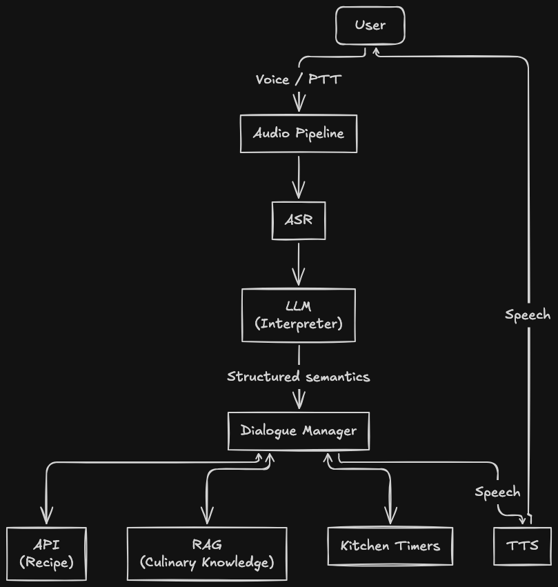
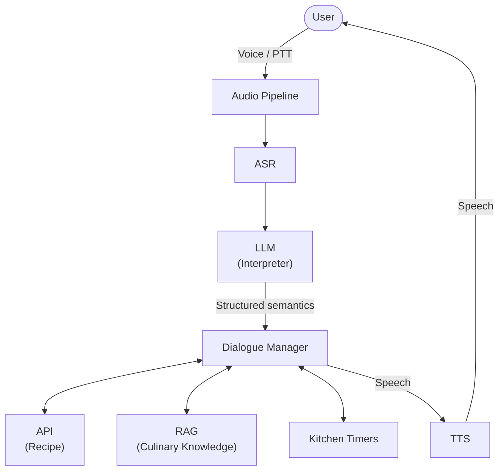

# CookMate

A stateful spoken dialogue copilot combining deterministic state management, structured recipe APIs, and retrieval-augmented language models to assist users hands-free during procedural cooking tasks.

Built for the **LT2319 Dialogue Systems** course project at the University of Gothenburg.

---

## Documentation & Deliverables

| Deliverable | Formats / Links | Description |
| :--- | :--- | :--- |
| **Project Report** | [PDF](docs/report/report.pdf) · [Markdown](docs/report/report.md) | Final project report covering design rationale, architecture, spoken NLU pipeline, and evaluation. |
| **Presentation Slides** | [PDF](docs/presentation/slides.pdf) · [HTML](docs/presentation/slides.html) · [Markdown](docs/presentation/slides.md) | Slide deck presented for the course project showcase. |
| **Dialogue Transcripts** | [Markdown](docs/dialogues/dialogues.md) | Human-human and human-agent cooking dialogue transcripts (102 turns across 8 scenarios). |
| **Dialogue Analysis** | [Markdown](docs/dialogues/analysis.md) | Analysis of grounding, repair mechanisms, timing, and multimodal turn-taking phenomena. |
| **Dialogue Act Taxonomy** | [Markdown](docs/dialogue-acts.md) | 19-act communicative dialogue act schema with entity slots. |
| **Prompt Benchmarks** | [Markdown](docs/prompt-test-results.md) | Benchmark evaluation across LLM semantic parsing prompt formats. |

---

## Architecture Overview

<!--  -->


CookMate decomposes the cooking assistant into four modular subsystems to balance low-latency voice ergonomics, deterministic dialogue control, and grounded culinary advice:

- **Voice Interface**:
  - [openWakeWord](https://github.com/dscripka/openWakeWord) (`Hey Chef`) running client-side with ONNX Runtime Web for local hands-free wake word gating without a persistent open mic.
  - [Azure Speech SDK](https://azure.microsoft.com/en-us/products/ai-services/speech-to-text) (ASR / TTS) with custom push audio streams and Web Audio API audio chimes for subtle feedback.
- **Natural Language Understanding (NLU)**:
  - [Groq LPU](https://groq.com/) running `openai/gpt-oss-20b` for sub-second dialogue act classification and entity extraction.
  - Multi-turn conversational context injection resolving situational references (*"the second one"*, *"ready"*, *"how much butter?"*).
- **Dialogue Management & Runtime Orchestration**:
  - [SpeechState](https://github.com/speechstate/speechstate) ([changes](https://github.com/vladmaraev/speechstate/compare/master...gnowenegue:speechstate:feat/asr-audio-streaming-robustness)) + [XState v5](https://stately.ai/docs/xstate) for hierarchical dialogue policy (recipe search, paced 2-by-2 ingredient gathering, step navigation, and proactive timer prompts).
  - Dedicated **Web Worker** with 250ms timestamp-anchored heartbeats for drift-free concurrent kitchen timers immune to browser tab throttling.
- **Culinary Knowledge & Grounded RAG**:
  - [TheMealDB API](https://www.themealdb.com/) with two-stage recipe normalization (`Intl.Segmenter` + LLM refinement via Groq with `openai/gpt-oss-120b`).
  - [Transformers.js](https://huggingface.co/docs/transformers.js) (`BAAI/bge-small-en-v1.5`) generating query embeddings entirely in-browser.
  - [Qdrant](https://qdrant.tech/) vector database indexing a section-aware Wikibooks culinary knowledge corpus (ingredient substitutions and techniques), synthesized under a strict 25-word spoken budget.

---

## Getting Started

### Prerequisites

- Node.js >= 24 (or LTS)
- `pnpm`
- Docker (for local Qdrant vector database)

### Setup & Execution

```bash
# 1. Install dependencies
pnpm install

# 2. Configure environment variables (Azure Speech, Groq API, etc.)
cp .env.example .env

# 3. Start local Qdrant vector database instance
docker compose up -d

# 4. Create collection and ingest culinary knowledge base into Qdrant
pnpm rag:cli createCollection
pnpm rag:cli addData data/knowledge

# 5. Start development web server
pnpm dev
```

### Verification & Testing

```bash
# Typecheck & lint check
pnpm verify

# Run unit tests
pnpm test
```
