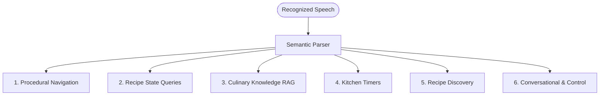

# Dialogue Acts & Semantic Entities Reference

This document defines the complete taxonomy of **Dialogue Acts** and **Semantic Entities** used by Cookmate. It serves as the formal specification for semantic parsing, intent extraction, state routing, and conversational policy.

---

## 1. Dialogue Act Taxonomy

Dialogue acts represent the pragmatic communicative intent of the user's spoken utterance. They are grouped into six functional categories:



---

### Category 1: Procedural Navigation

Commands that advance, rewind, or inspect steps during an active cooking session.

| Dialogue Act | Description | Example Spoken Utterances | Extracted Entities | Action Route |
| :--- | :--- | :--- | :--- | :--- |
| `NEXT_STEP` | Advances to the next sequential instruction. | *"Next"*, *"What's next?"*, *"Done"*, *"Finished chopping"* | None | `RECIPE_NAV` |
| `PREVIOUS_STEP` | Returns to the prior instruction. | *"Go back"*, *"Previous step"*, *"Wait, go back"* | None | `RECIPE_NAV` |
| `REPEAT_STEP` | Re-reads the current instruction. | *"Repeat that"*, *"What did you say?"*, *"Say again"* | None | `RECIPE_NAV` |
| `GOTO_STEP` | Jumps directly to a specific step number. | *"Jump to step 3"*, *"Go to step 5"*, *"Step 2"* | `stepNumber` | `RECIPE_NAV` |

---

### Category 2: Recipe State Queries (In-Memory Factual Lookups)

Queries answered directly from the active recipe's structured data layer (zero RAG / 100% factual).

| Dialogue Act | Description | Example Spoken Utterances | Extracted Entities | Action Route |
| :--- | :--- | :--- | :--- | :--- |
| `QUERY_INGREDIENT` | Asks about ingredient quantity, units, or presence in the recipe. | *"How much garlic do I need?"*, *"Do we need butter?"*, *"What ingredients are in this?"* | `ingredient` | `RECIPE_QUERY` |
| `QUERY_STEP_DETAIL` | Asks for clarification on specific parameters of the active step. | *"What temperature should the oven be?"*, *"Which pan should I use?"* | `query` | `RECIPE_QUERY` |

---

### Category 3: Culinary Knowledge & Troubleshooting (Qdrant RAG)

Open-ended culinary inquiries routed to vector search against the curated knowledge corpus.

| Dialogue Act | Description | Example Spoken Utterances | Extracted Entities | Action Route |
| :--- | :--- | :--- | :--- | :--- |
| `INQUIRE_SUBSTITUTION` | Inquires about ingredient substitutes, swaps, or dietary alternatives. | *"Can I use oat milk instead of heavy cream?"*, *"What can I substitute for garlic?"*, *"Can I swap it?"* | `ingredient`, `query` | `RAG_QUERY` (`substitutions`) |
| `INQUIRE_TECHNIQUE` | Inquires about culinary techniques, cooking cues, definitions, or symptoms. | *"What does sauté mean?"*, *"Why isn't this browning?"*, *"How do I know when onions are translucent?"* | `query` | `RAG_QUERY` (`techniques`) |

---

### Category 4: Kitchen Timers (Mixed-Initiative)

Timer commands enabling hands-free tracking of cooking durations.

| Dialogue Act | Description | Example Spoken Utterances | Extracted Entities | Action Route |
| :--- | :--- | :--- | :--- | :--- |
| `SET_TIMER` | Starts a countdown timer for a specified or inferred duration. | *"Set a timer for 10 minutes"*, *"Timer 8 minutes and 30 seconds for the pasta"*, *"Set a timer"* | `durationSeconds`, `timerLabel` | `TIMER_ACTION` |
| `CHECK_TIMER` | Checks the remaining time on an active timer. | *"How much time is left?"*, *"Timer status"*, *"How long on the pasta?"* | `timerLabel` | `TIMER_ACTION` |
| `CANCEL_TIMER` | Stops, cancels, or dismisses an active timer. | *"Cancel the timer"*, *"Stop the pasta timer"* | `timerLabel` | `TIMER_ACTION` |

---

### Category 5: Recipe Discovery & Selection

Commands used during the initial recipe selection phase prior to cooking.

| Dialogue Act | Description | Example Spoken Utterances | Extracted Entities | Action Route |
| :--- | :--- | :--- | :--- | :--- |
| `SEARCH_RECIPE` | Searches TheMealDB API by meal name, category, or ingredient. | *"Find an easy pasta recipe"*, *"Search for chicken curry"*, *"Something Italian"* | `query` | `DISCOVERY_ACTION` |
| `SELECT_RECIPE` | Selects a specific recipe candidate from presented options. | *"Let's make the second one"*, *"Choose Arrabiata"*, *"The first one"* | `stepNumber`, `query` | `DISCOVERY_ACTION` |

---

### Category 6: Conversational & Grounding

General dialogue management, turn acknowledgments, confirmations, and repairs.

| Dialogue Act | Description | Example Spoken Utterances | Extracted Entities | Action Route |
| :--- | :--- | :--- | :--- | :--- |
| `AFFIRM` | Positive confirmation, agreement, or readiness. | *"Yes"*, *"Yeah"*, *"Sure"*, *"Sounds good"*, *"Ready"* | None | `CONVERSATIONAL` |
| `DENY` | Rejection, cancellation, or disconfirmation. | *"No"*, *"Nope"*, *"Nevermind"*, *"Cancel"* | None | `CONVERSATIONAL` |
| `GREETING` | Opening salutation. | *"Hello"*, *"Hi copilot"*, *"Hey"* | None | `CONVERSATIONAL` |
| `HELP` | Requests assistance or instructions on what commands are available. | *"Help"*, *"What can you do?"*, *"What can I say?"* | None | `CONVERSATIONAL` |
| `UNKNOWN` | Unrecognized speech, inaudible utterance, or out-of-domain request. | *[inaudible noise]*, *"What's the weather today?"* | None | `CONVERSATIONAL` |

---

## 2. Semantic Entities

Entities are structured slots extracted from the user's speech to parameterize the dialogue acts. All entities are optional to ensure compact representations.

| Entity Slot | TypeScript Type | Description | Example Values |
| :--- | :--- | :--- | :--- |
| `ingredient` | `string` | The primary food item or ingredient in question. | `"garlic"`, `"heavy cream"`, `"penne"` |
| `stepNumber` | `number` | 1-indexed target step or selection index. | `1`, `3`, `5` |
| `query` | `string` | Free-form search term, technique, or substitute candidate for RAG / API queries. | `"Arrabiata"`, `"sauté"`, `"oat milk"` |
| `durationSeconds` | `number` | Normalized timer duration in seconds. | `30`, `600`, `2700` |
| `timerLabel` | `string` | Human-readable label identifying the timer target. | `"pasta"`, `"sauce"`, `"oven"` |

---

## 3. Dialogue Context Resolution (Ellipsis & Disambiguation)

Spoken interaction while cooking frequently involves elliptical phrases where the referent is omitted because hands are occupied. The XState dialogue manager (`src/dm.ts`) resolves these references against the active cooking state:

```text
User: "Can I substitute it?"
          │
          ▼
Dialogue manager inspects active step ingredients:
          │
          ├── Exactly 1 ingredient in step (e.g., "heavy cream")
          │     └── Auto-resolves: targetIngredient = "heavy cream" -> QueryRAG
          │
          └── Multiple ingredients in step (e.g., "olive oil" AND "garlic")
                └── Triggers CLARIFY: "Did you want to substitute olive oil or garlic?"
```

### Contextual Resolution Rules

1. **Pronoun Resolution (`"it"`, `"this"`)**:
   * If the user asks *"Can I substitute it?"* or *"How much of it?"*, the dialogue manager checks `ingredientsReferenced` on the active `RecipeStep`.
   * If a single ingredient is referenced, it resolves automatically without asking.
2. **Ambiguity Guard**:
   * If multiple ingredients are in the active step, the dialogue manager requests clarification rather than making an ungrounded guess.
3. **Timer Duration Inference**:
   * If the user says *"Set a timer"* without specifying a duration, the dialogue manager checks `estimatedMinutes` on the current step (e.g. 8 minutes for boiling pasta) and sets the timer automatically.

---

## 4. Spoken Delivery Guidelines (<25 Words)

Utterances generated for text-to-speech (TTS) follow spoken delivery constraints:

1. **Length Cap**: Prompt instructions steer generative responses to stay under **25 words** to prevent cognitive overload.
2. **Audio Text Sanitization**:
   * Visual markdown syntax (`**bold**`, `#`, bullet lists `-`, backticks, URLs) is stripped before passing text to the TTS engine.
   * Numerical fractions and measurement abbreviations (e.g. `1/2 cup`, `2 tbsp`, `10 mins`) are preserved as-is so Azure Neural TTS's native text normalization frontend speaks them with proper singular/plural grammar agreement.
