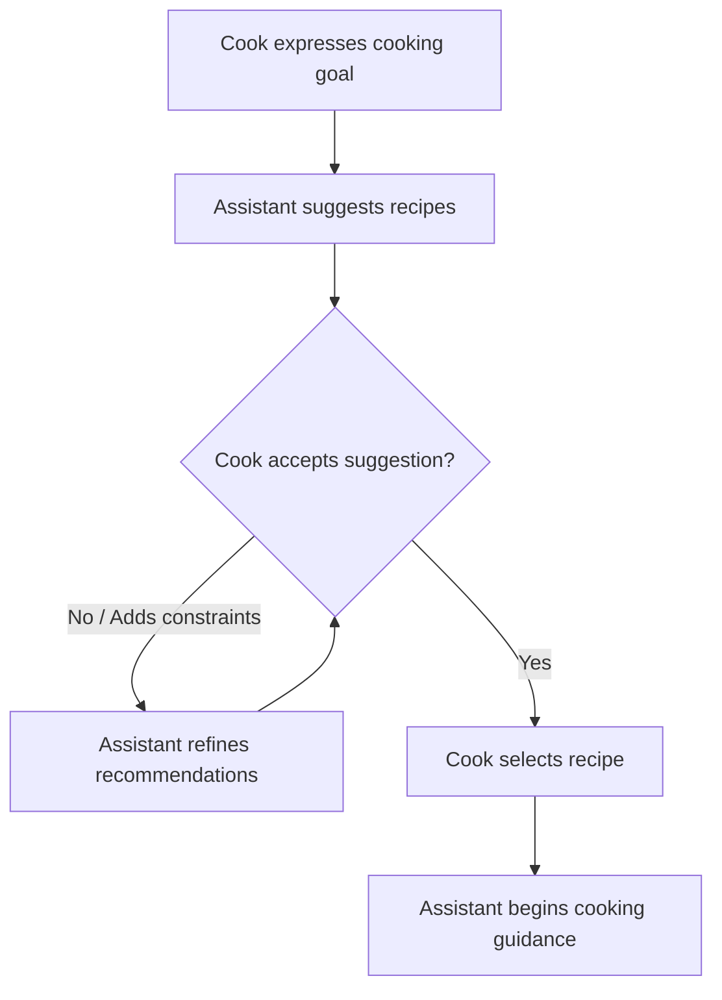
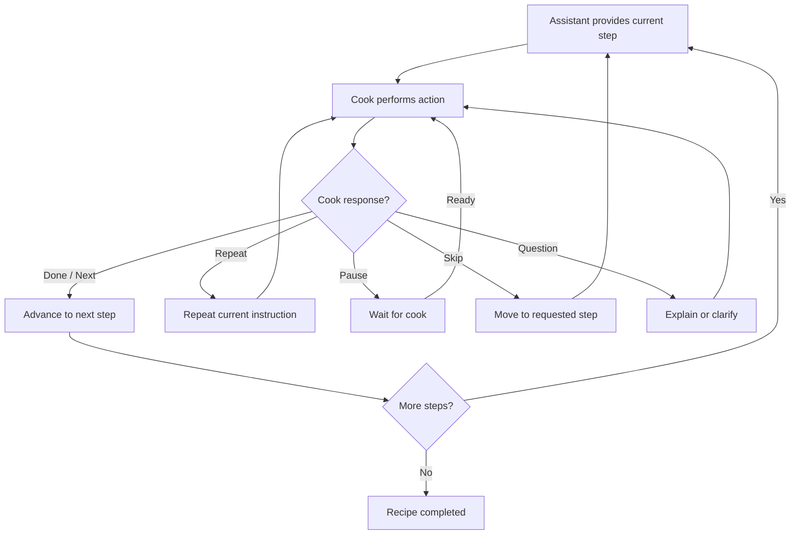
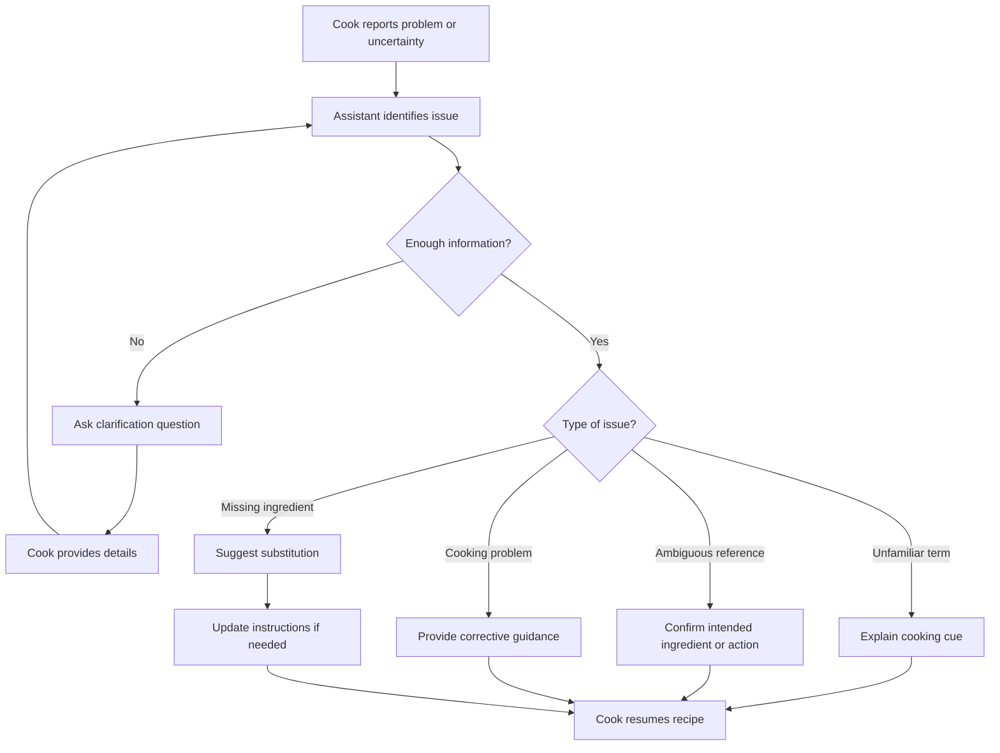
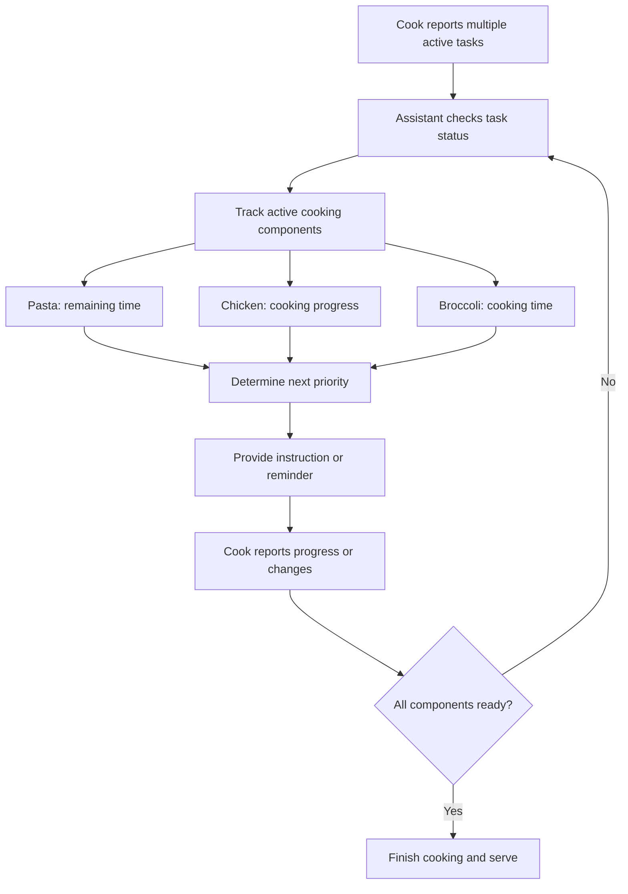

# Part 2: Interaction Pattern Analysis & System Requirements

## 1. Overview

We analyzed 8 simulated cooking dialogues (102 conversational turns) between a home cook and an assistant proxy. The goal was to understand how people naturally speak while cooking, uncover the technical capabilities a voice assistant actually needs, and sketch out the core conversation flows before building the system.

> **Note on data:** These transcripts were simulated rather than recorded from live kitchen experiments. They give us a realistic set of initial design hypotheses for our prototype, but real user tests will be needed later to validate edge cases.

---

## 2. How People Talk While Cooking

Cooking is hands-busy, messy, and distracting. The transcripts highlight three conversational realities that standard voice systems often struggle with:

### A. Context and Vague Words (Ellipsis & Pronouns)

Cooks rarely speak in complete, textbook sentences. Instead, they rely heavily on context and shorthand:

- *"Can I add it now?"* (Ambiguous: does "it" mean the chicken or the vegetables?)
- *"Would that work?"* (Referring to using milk and butter instead of heavy cream)
- *"What was the last one?"* (Referring to the last ingredient read aloud)

**Design rule:** The assistant cannot process utterances as isolated commands. It must maintain recent context (active step, recently mentioned ingredients). When a pronoun like *"it"* is ambiguous, the system should ask a quick clarifying question rather than make an unsafe guess.

### B. "I Heard You" vs. "I Did It" (Grounding)

A crucial nuance in hands-busy dialogue is distinguishing between understanding an instruction and completing it:

- **Acknowledgement:** *"Right, got it"* or *"Okay"* (Meaning: "I understand, give me a moment.")
- **Completion:** *"Done"*, *"They're in"*, or *"Onions are frying"* (Meaning: "I finished the physical action.")

**Design rule:** Never advance the recipe just because the cook acknowledged an instruction. Wait for an explicit completion signal or a prompt like *"What's next?"*.

### C. Cognitive Overload & Interruptions

Cooks get distracted by heat, timing, and physical chores:

- **Pacing control:** *"Sorry, hang on. I'm washing my hands. Say that again?"*
- **Non-linear jumps:** *"Wait, did you say three minutes or five?"* or *"Can we skip peeling?"*
- **Multitasking panic:** *"The pasta's boiling, the chicken's in the pan, and I've still got broccoli to cook. I'm getting a bit lost."*

**Design rule:** Spoken responses must be concise and bite-sized. The assistant must let the user pause, repeat, or skip steps without losing their place in the recipe.

---

## 3. Four Core Dialogue Patterns

Across the 8 dialogues, interactions naturally fall into four reusable flows. These serve as the direct blueprint for our dialogue manager's state machine:

### Pattern A: Recipe Discovery & Selection

Used when the user doesn't know what to cook yet (Dialogues 1 & 8).

- **Key behaviour:** Support iterative preference filtering (e.g., adding "under 20 minutes", "dairy-free", or removing an unavailable ingredient) without restarting the entire conversation.

### Pattern B: Step-by-Step Cooking Guidance

The core loop during active cooking (Dialogues 1, 3, 5 & 7).

- **Key behaviour:** Deliver one manageable instruction at a time, track the active step, and smoothly handle interruptions (repeating, pausing, or skipping) while keeping the cooking state intact.

### Pattern C: Clarification & Problem Recovery

Triggered when an ingredient is missing, instructions are ambiguous, or cooking cues are unfamiliar (Dialogues 2, 3, 5 & 6).

- **Key behaviour:** Answer side questions (e.g., *"What does shimmering oil look like?"*) or suggest ingredient substitutions, then return the cook directly to where they left off.

### Pattern D: Multitasking & Time Coordination

Used when managing multiple simultaneous cooking components and timers (Dialogues 4 & 7).

- **Key behaviour:** Track independent timers and step progress across multiple pots/pans simultaneously, prioritizing safety and time-sensitive alerts.

---

## 4. System Requirements & Scope

Based on the dialogue flows, here are the core requirements for the system, prioritized for prototype development:

| ID | Requirement | Priority | Why It Matters | Evidence |
| --- | --- | --- | --- | --- |
| **R1** | Recipe search & filtering | High | Recommends dishes based on user constraints (time, ingredients, diet). | D1, D8 |
| **R2** | Step-by-step spoken guidance | High | Delivers instructions incrementally in plain language. | D1, D5, D7 |
| **R3** | Cooking progress tracking | High | Maintains the active recipe step and whether actions are completed. | D1, D5, D7 |
| **R4** | Flexible navigation (pause, repeat, skip) | High | Lets the cook control pacing and jump around when needed. | D5, D7 |
| **R5** | Reference resolution & clarification | High | Resolves pronouns like *"it"* and asks concise questions when references are vague. | D2, D6 |
| **R6** | Ingredient substitutions | High | Suggests workable ingredient swaps and adapts recipe instructions accordingly. | D2, D8 |
| **R7** | Cooking terminology & sensory cues | Medium | Explains visual, sound, or smell cues (e.g., *"ripples in the oil"*). | D3 |
| **R8** | Timers & multitasking reminders | High | Tracks concurrent cooking activities and reminds cooks when items need attention. | D4 |
| **R9** | Informal speech handling | High | Handles common spoken hesitations, restarts, and self-corrections gracefully. | D1–D8 |
| **R10** | Dietary & pantry tracking | Medium | Remembers what ingredients the cook has or cannot eat. | D2, D8 |
| **R11** | Food safety guidance | High | Provides reliable guidance on heat levels, doneness, and food safety. | D3, D4, D6 |
| **R12** | Concise spoken responses | High | Keeps spoken output short to avoid overwhelming a busy cook. | D1–D8 |

---

## 5. Summary & Limitations

A helpful cooking assistant cannot just be a rigid screen-reader that recites instructions. It must be **context-aware, user-paced, and resilient to interruptions**.

- **Corpus Limitation:** These patterns and requirements are derived from 8 simulated dialogues rather than live field recordings. While they provide a solid foundation for the initial prototype, testing the system with actual cooks (e.g., in a Wizard-of-Oz setup) will be essential to catch unexpected real-world behaviors and refine the dialogue policies.
