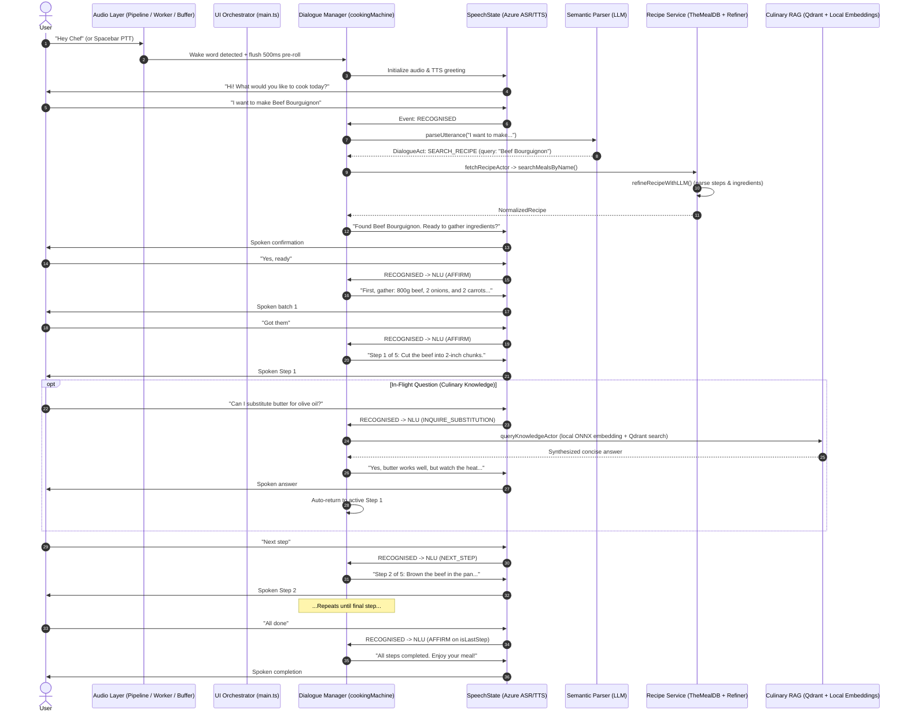

# CookMate Happy Flow Architecture & Interaction Lifecycle

This document describes the end-to-end **Happy Flow** through all active modules in the CookMate conversational assistant (excluding the timer subsystem, which is not yet integrated into the live audio loop). It details the sequence of interactions, which module is active at each stage, and what each module does.

---

## 1. Module Inventory

CookMate coordinates several frontend, local machine learning, remote cloud, and state machine modules:

| Subsystem / Layer | Module | Location | Primary Responsibility |
| :--- | :--- | :--- | :--- |
| **Audio Hardware & Capture** | `AudioPipeline` | `src/audio/audio-pipeline.ts` | Captures microphone input via `getUserMedia`, downsamples to 16 kHz mono. |
| **Audio Processing** | `AudioProcessor` | `src/audio/audio-processor.ts` | Runs on `AudioWorkletNode` to produce 16 kHz Int16 PCM chunks (1,280 samples / 80ms). |
| **Audio Buffer** | `CircularAudioBuffer` | `src/audio/circular-buffer.ts` | Preserves a 500ms rolling pre-roll audio buffer to prevent cutting off speech onset. |
| **Wake Word Detection** | `WakeWordEngine` | `src/audio/wake-word/` | Runs openWakeWord ONNX model inside a dedicated Web Worker to spot *"Hey Chef"*. |
| **Manual Trigger** | `PushToTalkController` | `src/audio/ptt.ts` | Fallback Spacebar push-to-talk controller for keyboard activation. |
| **Audio Stream Bridge** | `AzurePushStreamAdapter` | `src/audio/azure-push-stream.ts` | Pipes 500ms pre-roll and real-time PCM audio chunks into Azure's `PushAudioInputStream`. |
| **Speech Lifecycle** | `SpeechState` (`spstRef`) | `speechstate` package | Azure Speech SDK wrapper handling cloud Automatic Speech Recognition (ASR) and Text-to-Speech (TTS). |
| **Dialogue Management** | `CookingMachine` | `src/dm/cooking-machine.ts` | XState v5 state machine driving conversation phases, guards, context, and speech transitions. |
| **Action Router** | `handleRecognised` | `src/dm/actions/` | Coordinates recognized speech with conversation context and translates it into state machine events. |
| **Natural Language Understanding** | `SemanticParser` | `src/semantic-parser/` | LLM-driven structured dialogue act classifier and entity extractor. |
| **LLM Client & Cost Tracker** | `LLM Client` | `src/llm/` | Interfaces with OpenAI / Groq chat completions in strict JSON mode with token usage logging. |
| **Recipe Discovery & API** | `TheMealDB API Client` | `src/recipes/api.ts` | Searches and retrieves meal recipes by name or ID from TheMealDB. |
| **Recipe Refiner** | `Recipe Refiner` | `src/recipes/refiner.ts` | Uses LLM to clean unformatted recipe text into structured, numbered steps with timing and ingredients. |
| **Culinary Knowledge RAG** | `RAG Service` | `src/rag/service.ts` | Local `@huggingface/transformers` feature extraction embeddings + Qdrant vector search + LLM synthesis. |
| **UI & Orchestrator** | `main.ts` & DOM | `src/main.ts` | Wires up audio streams, renders glowing status hero cards, chat history feed, and state badges. |

---

## 2. Sequence Diagram



---

## 3. Step-by-Step Lifecycle Breakdown

### Phase 1: Standby & Audio Hardware Capture
1. **`main.ts`**: Starts `dmActor` (XState), initializes `AudioPipeline`, `WakeWordEngine`, and `PushToTalkController`.
2. **`AudioPipeline`**: Requests a 16 kHz single-channel stream via `navigator.mediaDevices.getUserMedia`.
3. **`AudioProcessor` (AudioWorklet)**: Downsamples mic audio, aggregates samples into 80ms PCM frames (1,280 samples), and emits them to `AudioPipeline`.
4. **`CircularAudioBuffer`**: Continuously saves audio frames into a rolling 500ms pre-roll ring buffer.
5. **`WakeWordEngine`**: Runs in a background Web Worker, feeding frames into the openWakeWord ONNX model.
6. **`main.ts`**: Sets ambient hero card glow to `STANDBY`.

---

### Phase 2: Wake Word Activation & Greeting
1. **User**: Says *"Hey Chef"* (or hits `Spacebar`).
2. **`WakeWordEngine`**: Detects the wake word with confidence score $> 0.5$ and fires `onTrigger`.
3. **`AzurePushStreamAdapter`**: Pulls the 500ms pre-roll PCM chunk from `CircularAudioBuffer`, prepends it to the Azure push stream, and begins streaming live microphone chunks.
4. **`CookingMachine` (`cookingMachine.ts`)**: Receives event `WAKE_WORD` (or `PTT_TRIGGER` / `CLICK`), moving `Idle` $\rightarrow$ `Prepare` $\rightarrow$ `PromptRecipe`.
5. **`SpeechState` (`spstRef`)**: Initialized with Azure credentials; executes Text-to-Speech (TTS) for:
   > *"Hi! What would you like to cook today?"*
6. **`main.ts`**: Renders assistant message to chat history and switches hero banner to `SPEAKING`, transitioning to `LISTENING` on `SPEAK_COMPLETE`.

---

### Phase 3: Speech Recognition & Semantic NLU
1. **User**: Speaks *"I'd like to make Beef Bourguignon"*.
2. **`SpeechState` (`spstRef`)**: Azure ASR streams audio from `AzurePushStreamAdapter`, completes speech endpointing, and emits `RECOGNISED` with text payload.
3. **`handleRecognised`**: Extracts recent conversation history (last turns) and reads the current machine state (`PromptRecipe`) from the snapshot.
4. **`SemanticParser` (`parser.ts`)**:
   * Evaluates the utterance conditioned on the active state and conversation context.
   * Invokes `LLM Client` (`client.ts`) with prompt instructions to produce structured JSON.
   * Returns:
     ```json
     {
       "act": "SEARCH_RECIPE",
       "entities": { "query": "Beef Bourguignon" }
     }
     ```
5. **`handleRecognised`**: Emits `ACT_RESOLVED` and dispatches `{ type: 'SEARCH_RECIPE', query: 'Beef Bourguignon' }` to the machine.
6. **`main.ts`**: Attaches intent badge `[SEARCH_RECIPE]` to user chat bubble in UI.

---

### Phase 4: Recipe Discovery, Refinement & Confirmation
1. **`CookingMachine`**: Enters state `FetchingRecipe`, invoking child actor `fetchRecipeLogic`.
2. **`TheMealDB API Client` (`recipes/api.ts`)**: Calls endpoint `search.php?s=Beef Bourguignon`.
3. **`Recipe Refiner` (`recipes/refiner.ts`)**:
   * Receives raw meal instructions and ingredients from TheMealDB.
   * Invokes `LLM Client` to parse raw instructions into clean, sequentially numbered cooking steps with estimated total duration.
   * Structures ingredients with standardized quantities and units.
4. **`fetchRecipeLogic`**: Returns normalized and refined recipe object.
5. **`CookingMachine`**: Transitions to `ConfirmRecipe`. Context is updated with `recipe`, `currentStepIndex: 0`, and `prepBatchIndex: 0`.
6. **`SpeechState`**: Synthesizes speech:
   > *"Found Beef Bourguignon. It takes about 60 minutes. Ready to gather ingredients?"*

---

### Phase 5: Paced Ingredient Preparation
1. **User**: Says *"Yes, I am"* $\rightarrow$ ASR emits `RECOGNISED` $\rightarrow$ `SemanticParser` returns `AFFIRM`.
2. **`CookingMachine`**: Moves to `AnnouncePrepBatch` $\rightarrow$ `WaitingForPrepConfirmation`.
3. **`formatPrepBatchUtterance` (`helpers.ts`)**:
   * Slices ingredients into manageable batches (3–4 items per batch) to avoid overwhelming the cook.
   * Formats speech: *"First, gather: 800g beef chuck, 2 diced onions, and 2 sliced carrots. Let me know when you have them."*
4. **`SpeechState`**: Speaks batch 1.
5. **User**: Says *"Got them"* $\rightarrow$ `SemanticParser` resolves `AFFIRM`.
6. **`CookingMachine`**: Guard `hasMorePrepBatches` checks remaining items:
   * If ingredients remain: increments `prepBatchIndex` and re-enters `AnnouncePrepBatch`.
   * When all items are gathered: transitions to `AnnounceStep`.

---

### Phase 6: Step-by-Step Cooking Navigation & In-Flight Knowledge
1. **`CookingMachine`**: Enters `AnnounceStep` $\rightarrow$ `WaitingForStepCommand`.
2. **`formatStepUtterance` (`helpers.ts`)**: Formats step 1: *"Step 1 of 5: Cut the beef into 2-inch chunks and pat dry with paper towels."*
3. **`SpeechState`**: Speaks step 1.

#### In-Flight Interruption / Knowledge Query (RAG Branch):
1. **User**: Asks *"Can I substitute olive oil for butter?"*
2. **`SemanticParser`**: Resolves dialogue act `INQUIRE_SUBSTITUTION` with entity `{ query: "olive oil for butter" }`.
3. **`CookingMachine`**:
   * Saves `returnState = 'WaitingForStepCommand'`.
   * Transitions to `QueryingKnowledge`.
4. **`queryKnowledgeLogic` (`actors/query-knowledge.ts`)**: Prepares query, step context (*"Step 1: Cut the beef..."*), and category filter (`substitutions`).
5. **`RAG Service` (`rag/service.ts`)**:
   * Uses local `@huggingface/transformers` feature extraction pipeline (`bge-small-en-v1.5`) running in-browser to embed the query into a 384-dimensional vector.
   * Executes similarity search via `QdrantClient` on collection `culinary_knowledge`.
   * Uses `LLM Client` to synthesize a concise, spoken answer (1–2 sentences) based on retrieved chunks and current step context.
6. **`CookingMachine`**: Transitions to `SpeakingKnowledge`.
7. **`SpeechState`**: Speaks the culinary advice.
8. **`CookingMachine`**: On `SPEAK_COMPLETE`, evaluates `returnState` and returns directly to `WaitingForStepCommand` on Step 1, seamlessly reopening the microphone.

#### Step Advancement:
1. **User**: Says *"Next step"* (or *"Done"* / *"Finished"*).
2. **`SemanticParser`**: Resolves `NEXT_STEP`.
3. **`CookingMachine`**: Increments `currentStepIndex`, transitions to `AnnounceStep`, and reads step 2.

---

### Phase 7: Completion
1. **User**: Says *"Finished"* on step 5.
2. **`CookingMachine`**: Guard `isLastStep` evaluates to `true`, transitioning to state `Completed`.
3. **`SpeechState`**: Speaks closing utterance:
   > *"All steps completed. Enjoy your meal!"*
4. **`CookingMachine` & `main.ts`**:
   * Sets `speechStatus` to `idle`.
   * Resets session context (`recipe`, `recipeCandidates`, `currentStepIndex`, `prepBatchIndex`).
   * UI hero banner returns to `STANDBY`, ready for the next wake word.
