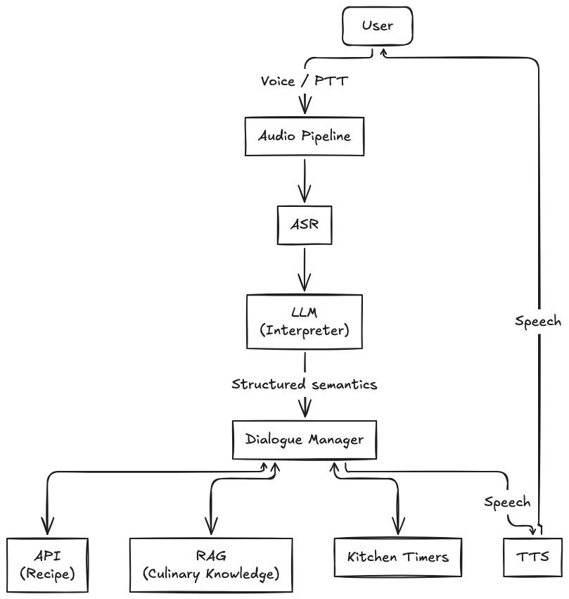

# CookMate: An Interactive Cooking Copilot

LT2319 Dialogue Systems 2 (2026)\
**Author:** Eugene Wong

---

## Table of Contents

- [CookMate: An Interactive Cooking Copilot](#cookmate-an-interactive-cooking-copilot)
  - [Table of Contents](#table-of-contents)
  - [1. Introduction \& Problem](#1-introduction--problem)
    - [1.1 Cooking as a Dialogue Domain](#11-cooking-as-a-dialogue-domain)
    - [1.2 Why Pure LLM Chatbots Fail in the Kitchen](#12-why-pure-llm-chatbots-fail-in-the-kitchen)
      - [1.2.1 State Amnesia](#121-state-amnesia)
      - [1.2.2 Hallucination Risks](#122-hallucination-risks)
      - [1.2.3 Poor Voice Ergonomics](#123-poor-voice-ergonomics)
      - [1.2.4 No Grounded Action](#124-no-grounded-action)
    - [1.3 Project Goal \& Overview](#13-project-goal--overview)
  - [2. Pre-existing API](#2-pre-existing-api)
    - [2.1 TheMealDB: Our Recipe Data Source](#21-themealdb-our-recipe-data-source)
    - [2.2 What the Raw Recipe Data Looks Like](#22-what-the-raw-recipe-data-looks-like)
    - [2.3 Challenges With TheMealDB](#23-challenges-with-themealdb)
    - [2.4 Recipe Normalization \& Refinement](#24-recipe-normalization--refinement)
  - [3. Data Collection \& Distillation](#3-data-collection--distillation)
    - [3.1 Data Collection Scenario \& Setup](#31-data-collection-scenario--setup)
    - [3.2 How People Talk While Cooking](#32-how-people-talk-while-cooking)
    - [3.3 What the Assistant Needs to Understand](#33-what-the-assistant-needs-to-understand)
  - [4. System Architecture \& Implementation](#4-system-architecture--implementation)
    - [4.1 Architecture Overview](#41-architecture-overview)
    - [4.2 Hands-Free Audio Pipeline](#42-hands-free-audio-pipeline)
    - [4.3 Dialogue Flow \& Cooking Policy](#43-dialogue-flow--cooking-policy)
    - [4.4 Concurrent Kitchen Timers](#44-concurrent-kitchen-timers)
    - [4.5 Spoken NLU: Turning Speech into Actions](#45-spoken-nlu-turning-speech-into-actions)
    - [4.6 Culinary Knowledge \& Grounded Answers](#46-culinary-knowledge--grounded-answers)
  - [5. Sample Dialogue](#5-sample-dialogue)
    - [5.1 End-to-End Dialogue Walkthrough](#51-end-to-end-dialogue-walkthrough)
      - [Phase 1: Recipe Discovery \& Paced Prep](#phase-1-recipe-discovery--paced-prep)
      - [Phase 2: Active Cooking \& Mid-Step Interruption (RAG)](#phase-2-active-cooking--mid-step-interruption-rag)
      - [Phase 3: Proactive Timers \& Expiry Notification](#phase-3-proactive-timers--expiry-notification)
  - [6. Discussion \& Conclusion](#6-discussion--conclusion)
    - [6.1 Challenges](#61-challenges)
    - [6.2 Future Improvements](#62-future-improvements)
  - [7. Appendices](#7-appendices)
    - [Appendix A: System Setup \& Execution](#appendix-a-system-setup--execution)
      - [Prerequisites](#prerequisites)
      - [Setup \& Execution](#setup--execution)
    - [Appendix B: Raw \& Distilled Dialogue Transcripts](#appendix-b-raw--distilled-dialogue-transcripts)
      - [Excerpt 1: Mid-Step Ingredient Substitution (Dialogue 2)](#excerpt-1-mid-step-ingredient-substitution-dialogue-2)
      - [Excerpt 2: Concurrent Tasks \& Multitasking (Dialogue 4)](#excerpt-2-concurrent-tasks--multitasking-dialogue-4)
    - [Appendix C: Dialogue Acts \& Semantic Schema](#appendix-c-dialogue-acts--semantic-schema)
      - [Dialogue Act Taxonomy (19 Acts)](#dialogue-act-taxonomy-19-acts)
      - [Extracted Semantic Entities](#extracted-semantic-entities)

---

## 1. Introduction & Problem

### 1.1 Cooking as a Dialogue Domain

Cooking is a hands-busy and eyes-busy activity. It is a messy and noisy environment, and the user's attention is constantly divided between the recipe, the stove, and the ingredients. This makes it a challenging domain for dialogue systems, as the user cannot easily interact and give undivided attention to the system while performing the tasks.

In normal chatbot interaction, the user and system can adhere to strict turn-taking rules. In cooking, a single instruction like *"dice two onions"* or *"simmer the beef for 15 minutes"* is followed by minutes of silence. The dialogue system has to sit silently in the background while maintaining the context and state of the cooking process.

Cooking dialogues are rarely linear. User is easily distracted and may ask for clarifications, substitutions, or sensory feedback. The dialogue system has to be able to handle these interruptions and continue the conversation without losing track of the recipe.

- **Clarifying amounts:** *"Wait, how many tablespoons of butter was that?"*
- **Asking for substitutions:** *"I don't have heavy cream, what can I use?"*
- **Interpreting sensory cues:** *"What does al dente actually look like?"*
- **Controlling the pace:** *"Hold on, say that again, I was washing my hands."*

Concurrently, the system has to keep track of the recipe's progress, the timers, and the ingredients. It has to be able to provide the user with the next step, the remaining time, and the ingredients needed for the next step.

Additionally, the system must be able to distinguish between the user's verbal acknowledgment (*"Okay, got it"*) and actual task completion (*"Done"*), so it does not advance to the next step prematurely.

### 1.2 Why Pure LLM Chatbots Fail in the Kitchen

#### 1.2.1 State Amnesia

Pure LLM chatbots do not maintain deterministic state. Even within a large context window, prompt-based LLMs generate turns probabilistically. When a user interrupts to ask a question, the LLM often forgets which step was active, repeats instructions, or jumps ahead. A procedural task requires a state machine to guarantee strict step progression.

#### 1.2.2 Hallucination Risks

LLMs are known to hallucinate. This is a major safety concern for cooking domain as the user may follow incorrect ingredients or instructions and end up with a bad meal or even worse, a dangerous situation.

#### 1.2.3 Poor Voice Ergonomics

For cooking dialogues, we expect the response to be fast and concise. Throughout the cooking process, every second counts. The user already has to multi-task, and the dialogue system should not add to the cognitive load. Keeping the response short so that the user can quickly understand and act on it is crucial.

#### 1.2.4 No Grounded Action

Pure LLM chatbots are reactive. They only generate text when prompted by the user. They have no built-in mechanism to maintain asynchronous background timers or proactively alert the user when the timer is up.

### 1.3 Project Goal & Overview

The goal of CookMate is to create a stateful, hands-free spoken cooking copilot that can assist the user throughout the whole cooking process. It should be flexible enough to handle interruptions and clarifications, and provide the user with the necessary information to continue cooking. It should also be able to set-and-forget timers in the background and alert the user when the timer is up.

The system is complicated, therefore we modularize the system into several components. We will discuss the components in detail in the later sections. We also try to keep everything offline and implement caching to reduce latency.

---

## 2. Pre-existing API

### 2.1 TheMealDB: Our Recipe Data Source

For the recipes, CookMate uses [TheMealDB](https://www.themealdb.com/), an open community-curated database containing around 300 recipes gathered from various web sources. The API allows searching and filtering recipes by name, category, or main ingredient, and retrieving full recipe details by meal ID.

### 2.2 What the Raw Recipe Data Looks Like

```json
{
  "idMeal": "52772",
  "strMeal": "Teriyaki Chicken Casserole",
  "strCategory": "Chicken",
  "strIngredient1": "soy sauce",
  "strMeasure1": "3/4 cup",
  "strIngredient2": "water",
  "strMeasure2": "1/2 cup",
  "...": "...",
  "strIngredient20": "",
  "strMeasure20": "",
  "strInstructions": "Preheat oven to 350° F. Spray pan with cooking spray. Boil water in a small saucepan, then stir in soy sauce..."
}
```

### 2.3 Challenges With TheMealDB

- **Rigid 20-Slot Schema:** Ingredients and measurements are flattened into 20 hardcoded key pairs (`strIngredient1..20` and `strMeasure1..20`).
- **Unstructured Instructions:** Cooking instructions are stored as a single, unformatted text paragraph (`strInstructions`). As the recipes come from various sources, the writing styles and formatting vary.
- **Data Inconsistencies:** Measurements are inconsistent (mixing cups, grams, tablespoons, or omitting units entirely). Writing styles vary, and typos are common.
- **Missing Ingredients:** Instructions frequently call for basic ingredients (such as water, salt, black pepper, or cooking oil) that were omitted from the formal ingredient list.
- **Zero Culinary Knowledge:** The recipes lack cooking information like preparation times, temperature definitions, or ingredient substitutions.

### 2.4 Recipe Normalization & Refinement

To resolve the challenges mentioned, CookMate processes each recipe through a two-stage pipeline upon selection:

1. **Rule-Based Code Cleanup:** We pair the ingredients `strIngredient` with their measurements `strMeasure`. Then we use `Intl.Segmenter` to split the raw instruction block into discrete, single-action sentences.
2. **LLM Refinement:** We expand all abbreviations to proper wording (e.g., *"tbsp"* $\rightarrow$ *"tablespoon"*). We also add all the missing ingredients that are mentioned in the instructions but not in the ingredient list. Finally, we make sure each step of the instructions are short and concise, under 25 words.

Eventually, we cache the refined recipes in the browser `localStorage` by meal ID, so this process only runs once per recipe.

---

## 3. Data Collection & Distillation

### 3.1 Data Collection Scenario & Setup

We generated 8 synthetic dialogue sessions (102 conversational turns) simulating interactions between a home cook and a cooking assistant. The simulated scenarios covered everyday dishes with varying cooking techniques, ingredient preparation steps, and timing requirements, providing an initial baseline of realistic speech patterns to design the system.

### 3.2 How People Talk While Cooking

- **Context-heavy and Vague:** Users rarely speak in complete sentences. They often omit words and rely on pronouns and context to convey meaning:
  - *"Can I add it now?"* - referring to the ingredient in the previous step.
  - *"Would that work?"* - asking if the substitution would work.
- **Grounding Difference:** There is a difference between acknowledging the instruction (*"Okay, got it"*) and actually completing the task (*"Done"*).
- **Pacing Control:** Users often pause or ask to repeat instructions.
- **Interruptions:** Users may ask for clarifications, substitutions, or sensory feedback.

### 3.3 What the Assistant Needs to Understand

We can break down the user's utterances into 4 categories of intents:

1. Step Navigation\
  `NEXT_STEP`, `PREVIOUS_STEP`, `REPEAT_STEP`, `GOTO_STEP`, `SKIP_PREP`
2. Cooking Questions\
  `QUERY_INGREDIENT`, `QUERY_STEP_DETAIL`, `INQUIRE_SUBSTITUTION`, `INQUIRE_TECHNIQUE`
3. Timers\
   `SET_TIMER`, `CHECK_TIMER`, `CANCEL_TIMER`
4. Search & Basic Chat\
  `SEARCH_RECIPE`, `SELECT_RECIPE`, `AFFIRM`, `DENY`, `GREETING`, `HELP`, `UNKNOWN`

We also extracted the following key entities:

- `ingredient`
- `stepNumber`
- `durationSeconds`
- `timerLabel`
- `query`

---

## 4. System Architecture & Implementation

### 4.1 Architecture Overview

{width=75%}

As the system is complicated, we modularize the system into 4 main components:

1. **Voice Interface:** `openWakeWord`, `SpeechState` ([changes](https://github.com/vladmaraev/speechstate/compare/master...gnowenegue:speechstate:feat/asr-audio-streaming-robustness))\
Handles hands-free wake word detection, speech-to-text, and text-to-speech.
1. **NLU:** `Groq`, `openai/gpt-oss-20b`\
Converts user utterances into structured dialogue acts and entities.
1. **Orchestration & Runtime:** `XState`, `Web Worker`\
Orchestrates the dialogue flow and manages the state of the cooking session. Allows for concurrent timers.
1. **Culinary Knowledge & RAG:** `TheMealDB`, `Qdrant`, `Transformers.js`, `Groq`, `openai/gpt-oss-120b`\
Normalizes and refines recipes, and provides grounded answers to user queries.

### 4.2 Hands-Free Audio Pipeline

Keeping an open mic is not ideal in a noisy environment like the kitchen. It would cause frequent false triggers from the noises.

To address this, we use a wake word detection model to trigger the speech-to-text pipeline. This is so that whenever the user needs to speak with CookMate, they can say the wake word `Hey Chef` first, and then speak their command. After CookMate responds, it maintains an 8-second buffer to allow the user to continue speaking without having to say the wake word again.

There is also a chime sound whenever CookMate is triggered or goes back to sleep mode. This is to provide audio feedback to the user.

### 4.3 Dialogue Flow & Cooking Policy

Instead of reciting a long list of ingredients all at once, CookMate will group the ingredients into batches of 2 (*"Gather 2 onions and 3 cloves of garlic"*). It then waits for the user to confirm before proceeding to the next batch. The user can also choose to skip the preparation of ingredients and jump straight into the cooking steps.

The cooking steps are progressed sequentially one step at a time. The user can also choose to jump to a specific step, repeat the current step, or go back to the previous step.

In the midst of cooking, the user can also ask for substitutions, ingredient details, or technique clarifications. CookMate will provide grounded answers based on the recipe and culinary knowledge, while remaining anchored to the current step.

When the current step contains an explicit duration, CookMate will proactively ask the user if they want to set a timer. If the user agrees, CookMate will set a timer and remind the user when the timer is up. The user can also check the timer status or cancel the timer at any time.

### 4.4 Concurrent Kitchen Timers

Timers on a browser have a few challenges. When a tab is backgrounded or a screen dims, browsers aggressively throttle JavaScript timers to conserve battery, causing severe drift or missed alarms. Even when active, single-threaded JavaScript execution can delay timer execution if the main thread is busy with rendering or computation.

To address this, we use a Web Worker to run the timer in a separate thread. This ensures that the timer will continue to run even if the browser tab goes to sleep.

Instead of using `setInterval` or `setTimeout`, we utilize a heartbeat mechanism to check the timer status every 250ms. The timer status is stored as a timestamp, so we are relying on actual time to determine when the timer should go off.

### 4.5 Spoken NLU: Turning Speech into Actions

User utterances are parsed with `openai/gpt-oss-20b` with Groq. Groq uses LPU which ensures fast responses. The NLU outputs a JSON object that contains the dialogue act and the entities, which is then used to update the dialogue state. In each utterance, the last few utterances are also passed into the NLU to provide context. This resolves value ambiguity. For example:

- In *Recipe Search*: *"the second one"* &rarr; `SELECT_RECIPE`
- In *Ingredient Prep*: *"ready"* &rarr; `NEXT_STEP`
- In *Cooking Step*: *"how much butter?"* &rarr; `QUERY_INGREDIENT`

### 4.6 Culinary Knowledge & Grounded Answers

When users ask question outside of the recipe such as ingredient substitutions or cooking techniques, the question will be redirected to the RAG system.

To keep things fast, we use a local LLM to generate the embeddings for the query with Hugging Face's `transformers.js` running `BAAI/bge-small-en-v1.5` ONNX model. This runs entirely offline in the browser. The embeddings are then queried against a local Qdrant vector database to retrieve the most relevant advice chunk with threshold of 0.6.

---

## 5. Sample Dialogue

### 5.1 End-to-End Dialogue Walkthrough

The following illustrates how CookMate guides a user through recipe discovery, paced ingredient preparation, mid-step culinary inquiries, and setting kitchen timers.

#### Phase 1: Recipe Discovery & Paced Prep
>
> **User:** *"I want to make Beef Noodles."*
> `[SEARCH_RECIPE { query: "Beef Noodles" }]`\
> *(System fetches, normalizes, and refines recipe from TheMealDB)*
>
> **CookMate:** *"Found Beef Noodles. Ready to gather ingredients?"*
>
> **User:** *"Yes, ready."*
> `[AFFIRM]`
>
> **CookMate:** *"First, gather 800 grams beef, 2 onions, and 2 carrots."* *(Batch 1 of 2)*
>
> **User:** *"Got them."*
> `[AFFIRM]`
>
> **CookMate:** *"Next, gather 300 grams noodles, 2 tablespoons vegetable oil, and 1 liter beef broth."* *(Batch 2 of 2)*
>
> **User:** *"All set."*
> `[AFFIRM]`
>
> **CookMate:** *"Great! Let's start cooking. Step 1: Dice the onions and slice the carrots into rounds."*
>
#### Phase 2: Active Cooking & Mid-Step Interruption (RAG)
>
> **User:** *"Done."*
> `[NEXT_STEP]`
>
> **CookMate:** *"Step 2: Heat 2 tablespoons of vegetable oil in a large pot over medium heat."*
>
> **User:** *"Can I use butter instead?"*
> `[INQUIRE_SUBSTITUTION { ingredient: "vegetable oil", query: "butter" }]`\
> *(Query is being redirected to RAG system)*
>
> **CookMate:** *"Yes, butter works well, but keep the heat medium-low so it doesn't burn."*
>
> **User:** *"What's next?"*
> `[NEXT_STEP]`
>
#### Phase 3: Proactive Timers & Expiry Notification
>
> **CookMate:** *"Step 3: Sear the beef in batches for 5 minutes until browned on all sides. Would you like me to start a timer for 5 minutes?"*
>
> **User:** *"Yes please."*
> `[SET_TIMER { durationSeconds: 300, timerLabel: "sear beef" }]`\
> *(Web Worker starts 5-minute countdown anchored to timestamp)*
>
> **CookMate:** *"Starting a 5-minute timer for searing beef."*
>
> *(User continues cooking while timer runs in the background)*
>
> **User:** *"How much time left?"*
> `[CHECK_TIMER]`
>
> **CookMate:** *"There are 2 minutes and 40 seconds remaining on your beef timer."*
>
> *(Timer expires — Web Worker triggers chime and alert)*
>
> **CookMate:** *(Chime)* *"Your 5-minute sear timer is finished. Ready for step 4?"*
>
> **User:** *"Yes."*
> `[AFFIRM]`
>
> **CookMate:** *"Step 4: Pour in the beef broth and scrape up any browned bits from the bottom of the pot."*

---

## 6. Discussion & Conclusion

CookMate demonstrates an effective voice assistant for cooking when using the right tool for the job and separation of concerns in modular design. Instead of delegating everything to a monolithic LLM, we use XState to orchestrate the dialogue state and use RAG to provide grounded answers. We try to keep things running offline by using cache and local LLM to keep things fast and responsive.

### 6.1 Challenges

- **Barge-In Instability:**
  *Issue:* Erratic behavior when SpeechState transits between TTS and ASR states during barge-in attempts.
  *Decision:* To ensure reliability for the course prototype and live demo, barge-in is disabled. CookMate remains as a turn-based dialogue system.
- **Two-Tier LLM Architecture:**
  *Issue:* The smaller model `openai/gpt-oss-20b` on Groq struggles to output complex nested JSON when refining recipes.
  *Decision:* The larger model `openai/gpt-oss-120b` is used to refine the recipe. Since it is a slower process for refinement, the recipe is cached in local storage in the browser to avoid repeated refinement.
- **JavaScript Timer Bottleneck:**
  *Issue:* Browsers aggressively throttle JavaScript timers (`setInterval` / `setTimeout`), causing timers to be inaccurate.
  *Decision:* Timers are anchored to timestamps (`Date.now() + duration`) and driven by a Web Worker heartbeat every 250ms, which modern browsers do not throttle.
- **Missing Ingredients in Raw API Data:**
  *Issue:* A lot of the recipes from TheMealDB are missing basic ingredients that are mentioned in the instructions.
  *Decision:* Use LLM to do a recipe refinement that scans the instructions for ingredients and insert them into the ingredient list.

### 6.2 Future Improvements

- **Barge-In:** This is to allow users to interrupt CookMate mid-sentence. This was enabled initially as it was supported by SpeechState. However, as development progresses, there are some erratic behaviors that couldn't be fixed within the timeframe.
- **Dynamic Portion Scaling:** Currently, TheMealDB API provides an unknown portion size, depending on the recipe that it's sourced from. An improvement would be to allow users to specify the number of servings they want to cook for and scale the recipe accordingly.
- **Persistent Dietary & Pantry Memory:** To make CookMate more personalized, it would be beneficial to store user preferences and allergies. This would allow CookMate to suggest or modify recipes accordingly.

---

## 7. Appendices

### Appendix A: System Setup & Execution

#### Prerequisites

- Node.js (LTS version)
- `pnpm`
- Docker (for local Qdrant vector database)

#### Setup & Execution

```bash
# 1. Install dependencies
pnpm install

# 2. Start local Qdrant vector database instance
docker compose up -d

# 3. Create collection and ingest culinary knowledge base into Qdrant
pnpm rag:cli createCollection
pnpm rag:cli addData data/knowledge

# 4. Start development web server
pnpm dev

# 5. Typecheck, lint, and run tests
pnpm verify
pnpm test
```

---

### Appendix B: Raw & Distilled Dialogue Transcripts

Full transcripts available in `docs/dialogues/dialogues.md`. Below are two representative excerpts:

#### Excerpt 1: Mid-Step Ingredient Substitution (Dialogue 2)

**Cook Goal:** Continue preparing a creamy mushroom sauce after discovering that a required ingredient is unavailable.

**Transcript (12 turns)**

> **Cook:** "Okay, the mushrooms are cooking. What's next?"
>
> **Assistant:** "Next, pour in about half a cup of heavy cream and stir it through the mushrooms."
>
> **Cook:** "Ah, wait. I don't have cream. I thought I did."
>
> **Assistant:** "No problem. Do you have milk, cream cheese, or maybe some plain yogurt?"
>
> **Cook:** "I've got milk and, uh, a bit of butter. Would that work?"
>
> **Assistant:** "Yes. Use about half a cup of milk and a tablespoon of butter. The sauce will be lighter than with cream."
>
> **Cook:** "Okay. Do I just pour the milk straight in?"
>
> **Assistant:** "First turn the heat down to low, then add the milk gradually while stirring."
>
> **Cook:** "Hang on, it's looking really watery now. Is that normal?"
>
> **Assistant:** "That's expected with milk. Let it simmer gently for a few minutes. You can also add a little grated cheese if you have some."
>
> **Cook:** "Oh, I've got Parmesan. How much?"
>
> **Assistant:** "Start with two tablespoons, stir it in, and see how the sauce thickens."

#### Excerpt 2: Concurrent Tasks & Multitasking (Dialogue 4)

**Cook Goal:** Coordinate the timing of pasta, chicken, and broccoli so that all components finish cooking at approximately the same time.

**Transcript (14 turns)**

> **Cook:** "Okay, the pasta's boiling, the chicken's in the pan, and I've still got broccoli to cook. I'm getting a bit lost."
>
> **Assistant:** "Alright. How long has the pasta been cooking?"
>
> **Cook:** "Um, maybe five minutes? The packet says ten."
>
> **Assistant:** "Okay, so roughly five minutes left. How's the chicken looking?"
>
> **Cook:** "It's browned on one side. I just flipped it."
>
> **Assistant:** "Good. Keep it cooking over medium heat. If they're small pieces, they may need another four or five minutes, but check they're cooked through."
>
> **Cook:** "Right. When should I start the broccoli?"
>
> **Assistant:** "Start it now if you're steaming it. It should take around four to five minutes."
>
> **Cook:** "Okay, can you remind me to check the pasta in, like, three minutes?"
>
> **Assistant:** "Sure, I'll keep track of three minutes for the pasta check."
>
> **Cook:** "Wait, should I turn the chicken down? It's getting pretty dark."
>
> **Assistant:** "Yes, lower the heat a little so the outside doesn't burn. Make sure the centre reaches 74 degrees Celsius before serving."
>
> **Cook:** "Okay. And the broccoli, how long again?"
>
> **Assistant:** "About four to five minutes from when it starts steaming. You want it tender but still slightly firm."

---

### Appendix C: Dialogue Acts & Semantic Schema

#### Dialogue Act Taxonomy (19 Acts)

| Category | Dialogue Act | Description | Example Spoken Input | Routed Action |
| :--- | :--- | :--- | :--- | :--- |
| **Step Navigation** | `NEXT_STEP` | Advances to next sequential step | *"Next"*, *"Done"*, *"Finished chopping"* | Advance active recipe step |
| | `PREVIOUS_STEP` | Returns to prior instruction | *"Go back"*, *"Previous step"* | Decrement active recipe step |
| | `REPEAT_STEP` | Repeats current instruction | *"Say that again"*, *"Repeat please"* | Re-speak current step |
| | `GOTO_STEP` | Jumps to specific step number | *"Jump to step 4"*, *"Go to step 2"* | Set step index directly |
| | `SKIP_PREP` | Skips ingredient gathering | *"I have everything, start cooking"* | Jump to step 1 |
| **Recipe Queries** | `QUERY_INGREDIENT` | Factual ingredient lookup | *"How much butter do I need?"* | In-memory recipe lookup |
| | `QUERY_STEP_DETAIL` | Clarification on active step | *"What temperature for the oven?"* | In-memory recipe lookup |
| **Culinary RAG** | `INQUIRE_SUBSTITUTION` | Ingredient swaps/alternatives | *"Can I use butter instead of oil?"* | Qdrant vector search |
| | `INQUIRE_TECHNIQUE` | Cooking definitions or cues | *"What does sauté mean?"* | Qdrant vector search |
| **Kitchen Timers** | `SET_TIMER` | Starts countdown timer | *"Set a timer for 5 minutes"* | Start Web Worker timer |
| | `CHECK_TIMER` | Inquires time remaining | *"How much time left?"* | Query Web Worker timer |
| | `CANCEL_TIMER` | Cancels active timer | *"Stop the timer"*, *"Cancel timer"* | Clear Web Worker timer |
| **Search & Selection** | `SEARCH_RECIPE` | Searches recipes by name/item | *"I want to make Beef Noodles"* | Query TheMealDB |
| | `SELECT_RECIPE` | Chooses candidate recipe | *"The first one"*, *"Select recipe 2"* | Hydrate selected recipe |
| **Conversational** | `AFFIRM` | Confirms action or presence | *"Yes"*, *"Got them"*, *"Ready"* | Advance paced batch / confirm |
| | `DENY` | Rejects suggestion or action | *"No"*, *"Not that one"* | Cancel / fallback |
| | `GREETING` | Friendly salutation / opening | *"Hello"*, *"Hi CookMate"* | Spoken contextual greeting |
| | `HELP` | Requests guidance or commands | *"What can I say?"*, *"Help"* | Spoken contextual help prompt |
| | `UNKNOWN` | Inaudible speech or unmapped intent | *(Inaudible)*, *"Mumble"* | Spoken clarification repair prompt |

#### Extracted Semantic Entities

| Entity | Data Type | Description | Example Values |
| :--- | :--- | :--- | :--- |
| `ingredient` | `string` | Target ingredient for lookups or swaps | `"butter"`, `"olive oil"`, `"heavy cream"` |
| `stepNumber` | `integer` | 1-based target step index for jumps | `1`, `3`, `5` |
| `durationSeconds` | `integer` | Timer duration parsed into seconds | `300` *(5 mins)*, `480` *(8 mins)* |
| `timerLabel` | `string` | Optional semantic label for the timer | `"pasta"`, `"beef"`, `"onions"` |
| `query` | `string` | Raw query string for RAG vector search | `"what does al dente look like"` |
