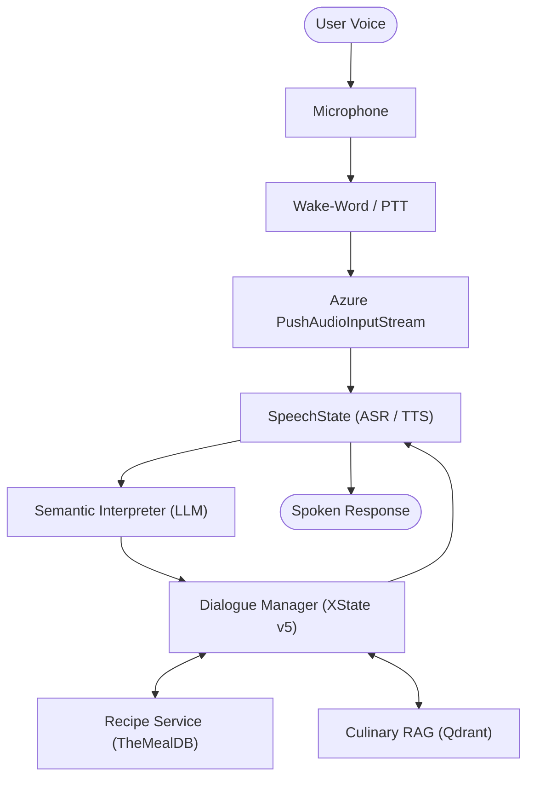

# Interactive Cooking Copilot — Project Roadmap

## Architecture Overview

A stateful spoken cooking assistant built with **SpeechState**, **XState v5**, **Azure Speech SDK** (with custom push audio stream), **openWakeWord** (in-browser WASM), **TheMealDB API**, and **Qdrant Vector DB** for culinary RAG.

---

## Phase 0: Workspace Scaffolding & Setup

- [x] Initialize Git repository, `.gitignore`, and `.node-version` (Node 24 LTS)
- [x] Configure `.env` and `.env.example` (secure Azure Speech & Qdrant credentials)
- [x] Link local forked `speechstate` and align `xstate` version (5.21.0)
- [x] Consolidate Qdrant `docker-compose.yml` and ingestion CLI (`scripts/rag-cli.ts`)
- [x] Verify project builds and type-checks with zero TypeScript errors

---

## Phase 1: Data Collection & Scenario Design (Course Requirement)

- [ ] Define human-human cooking scenario and participant prompt sheets (Cook vs. Assistant proxy)
- [ ] Record and transcribe 5–10 interaction sessions
- [ ] Distill recurring dialogue patterns (navigation, ingredient checks, substitutions, techniques, timers, repairs)

---

## Phase 2: Recipe Service & Data Layer

- [x] Implement TheMealDB API client (search by name, ID lookup, category/ingredient filter)
- [x] Build recipe normalizer (structured ingredients, sentence-level steps, estimated cooking times)
- [x] Add unit tests for recipe parsing and step extraction

---

## Phase 3: Audio Pipeline & Wake-Word

- [ ] Web Audio pipeline (16 kHz mono) with 500ms pre-roll circular buffer
- [ ] Custom Azure `PushAudioInputStream` adapter for SpeechState
- [ ] In-browser local wake-word engine (`openWakeWord` via ONNX Runtime Web)
- [ ] Spacebar Push-to-Talk (PTT) hotkey as live demo fallback

---

## Phase 4: Dialogue Manager (XState v5)

- [ ] Procedural cooking state machine (recipe selection, step navigation, ingredient checks)
- [ ] 8-second hands-free open-mic follow-up window after copilot utterances
- [ ] Mixed-initiative cooking timers with proactive voice expiry alerts
- [ ] Conversational repair and clarification handling

---

## Phase 5: Semantic Parsing & Spoken NLG

- [ ] Few-shot dialogue act extractor (mapping recognized speech to structured intents & entities)
- [ ] Dialogue action router (recipe state vs. RAG vs. timer actions)
- [ ] Spoken NLG prompt generator producing concise, natural responses (<25 words)

---

## Phase 6: Culinary Knowledge RAG (Qdrant)

- [ ] Curate markdown knowledge corpus (substitutions, cooking techniques, food safety temperatures)
- [ ] Ingest documents into Qdrant collection using `pnpm rag:cli`
- [ ] Build dialogue-state-aware retrieval service (incorporating active recipe context into queries)

---

## Phase 7: Hands-Free Kitchen Dashboard

- [ ] High-contrast cooking screen readable from distance (current step, ingredients, timer countdowns)
- [ ] Visual microphone status indicators (standby, listening, thinking, speaking)

---

## Phase 8: Testing & Course Deliverables (LT2319)

- [ ] Automated test suite for recipe normalizer and dialogue state transitions
- [ ] User testing sessions with 3–5 participants & usability analysis
- [ ] 15-minute presentation & live demo preparation
- [ ] Final written course report (system architecture, transcripts, evaluation)
